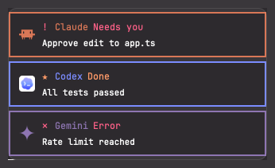

# herdr-agent-toast

Notification mods for [Herdr](https://herdr.dev): see at a glance which agent needs you and which one is done.
Every example tells agents apart by color and icon (Claude, Codex, Gemini, ...) and notifications apart by kind (Needs you, Done, Error, ...).
They differ in how they look and behave.

## Examples

| Example | What it is | Preview |
|---|---|---|
| [`toast-agent`](toast-agent/RECIPE.md) | Cards in the top-right corner, framed in each agent's color (start here) |  |

More examples are on the way.

## Install

With Herdr running (app 0.1.15 or newer), on macOS (Linux should work but is untested):

```
curl -fsSL https://raw.githubusercontent.com/0omin/herdr-agent-toast/main/install.sh | sh -s toast-agent
```

Three sample cards appear in the top-right corner when it is done.
The script copies the mod into `~/.config/herdr-app/mods/`, adds two entries to your layout, and backs up every file it changes.
A layout that ships with Herdr is cloned first, and the clone is the one that changes.
To take it out again, run the same line with `sh -s uninstall toast-agent`.

[docs/install.md](docs/install.md) says exactly what the script does, and how to install by reading it first, through your Herdr agent, or by hand.

Each example lives in its own folder with a `RECIPE.md` (what it does and how it is built) and a `preview.png`.

## Develop

`shared/core.js` is the one source for the code every example shares.
After editing it, run `scripts/sync-core.sh` to copy it into each mod folder.
`scripts/sync-core.sh --check` fails when a copy differs.

## Customize

The words, glyphs and timing are constants at the top of each `main.js`.
The agents and their colors are the `AGENTS` table in `core.js`.

## Versions

One version for the whole repo.
See [CHANGELOG.md](CHANGELOG.md).
Tested with Herdr app 0.1.15 on macOS.

## License

MIT.
Agent icons are not included; the mods use the ones that ship with Herdr.
