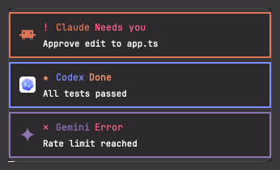
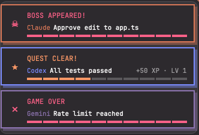
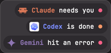
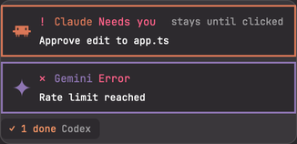
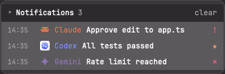
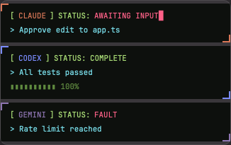
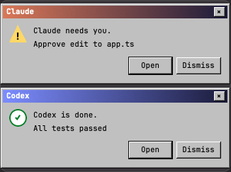

# herdr-agent-toast

Notification mods for [Herdr](https://herdr.dev): see at a glance which agent needs you and which one is done.
Every example tells agents apart by color (Claude, Codex, Gemini, ...) and notifications apart by kind (Needs you, Done, Error, ...).
They differ in how they look and behave.

## Examples

| Example | What it is | Preview |
|---|---|---|
| [`toast-agent`](toast-agent/RECIPE.md) | Cards in the top-right corner, framed in each agent's color (start here) |  |
| [`toast-quest`](toast-quest/RECIPE.md) | 8-bit game cards: a boss when an agent needs you, XP for every finished task, combos, trim levels and achievements |  |
| [`toast-minimal`](toast-minimal/RECIPE.md) | One thin pill per notification: who and what, with a dot for the kind; point at it to read the rest |  |
| [`toast-focus`](toast-focus/RECIPE.md) | Do not disturb: only needs-you and error cards show, and stay until clicked; finished tasks are just counted |  |
| [`toast-history`](toast-history/RECIPE.md) | A list that keeps the last 20 notifications: it opens for each new one, then folds into a badge with the number of new rows |  |
| [`toast-hud`](toast-hud/RECIPE.md) | A control-room screen: black panels, uppercase status codes, corner brackets in each agent's color, a blinking cursor when an agent needs you |  |
| [`toast-retro`](toast-retro/RECIPE.md) | Old desktop dialog boxes: a title bar in each agent's color, an icon for the kind, and Open and Dismiss buttons |  |

## Install

With Herdr running (app 0.1.15 or newer), on macOS (Linux should work but is untested):

```
curl -fsSL https://raw.githubusercontent.com/0omin/herdr-agent-toast/main/install.sh | sh -s toast-agent
```

Three sample cards appear in the top-right corner when it is done.
The script copies the mod into `~/.config/herdr-app/mods/`, adds two entries to your layout, and backs up every file it changes.
A layout that ships with Herdr is cloned first, and the clone is the one that changes.
To take it out again, run the same line with `sh -s uninstall toast-agent`.
For another example, put its name in place of `toast-agent`; it takes the spot of the one you have.

[docs/install.md](docs/install.md) says exactly what the script does, and how to install by reading it first, through your Herdr agent, or by hand.

Each example lives in its own folder with a `RECIPE.md` (what it does and how it is built) and a `preview.png`.

## Keyboard

Every example has a `pick` command: it numbers the cards and takes the keyboard, and a digit opens that card.
Enter opens the top one, and so does the same key again when it has cmd, ctrl or alt in it.
Any other key without cmd, ctrl or alt gives the keyboard back to the pane it came from.
Bind it to a key in the `global` section of `~/.config/herdr-app/keys.json`, for example `"cmd-j": "toast-agent.pick"`.

## Develop

`shared/core.js` is the one source for the code every example shares.
After editing it, run `scripts/sync-core.sh` to copy it into each mod folder.
`scripts/sync-core.sh --check` fails when a copy differs.

## Customize

The words, glyphs and timing are constants at the top of each `main.js`.
The agents and their colors are the `AGENTS` table in `core.js`.

## Versions

One version for the whole repo.
See [CHANGELOG.md](CHANGELOG.md).
Tested with Herdr app 0.1.16 on macOS (v1.0.0 and earlier: 0.1.15).

## License

MIT.
Agent icons are not included; the mods use the ones that ship with Herdr.
