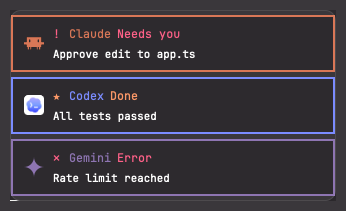

# Agent Toast

Notifications show as small cards stacked in the top-right corner of the window instead of the bottom toast.
Each card is framed in the color of the agent that sent it (Claude, Codex, Gemini, Cursor, ...) with that agent's icon.
Its heading says what happened: the agent needs you, finished, or something went wrong.

## What you see

- A column of up to 3 cards, 360 px wide, 6 px apart, in a floating block at the top edge, aligned to the end (right).
  Newest on top.
  The block is empty, and so hidden, when there are no cards.
- Each card: theme `background`, a 2 px frame in the agent color, padding 12 by 8, `selection` on hover.
  - Left: the agent icon, 22 px.
    Full-color icons are drawn as images; one-color icons are drawn in the agent color.
    No icon: a 22 px square in the frame color.
  - Heading row, 13 px bold: a glyph in the kind color, the agent name in the agent color, then the kind label in the kind color.
  - Line two, 12 px: the notification body, truncated.
    The title comes first unless it is Herdr's own "X needs you" / "X finished" for a known agent.
    Needs-you cards that have an action add `click to open` on the right, in `muted`.
- Agent colors: Claude `#D97757`, Codex `#7B8CFF`, Gemini `#8E75B2`, Cursor `#D6D8DB`, Copilot `#3FB950`, OpenCode `#F5A742`, Amp `#F34E3F`, Kiro `#9046FF`, Grok `#A0A4AB`, Kimi `#1783FF`, Crush `#FF6DAA`, Antigravity `#FFE432`.
  Other agents use Herdr's own name and icon for them, framed in the theme `accent`.
  Non-agent notifications show `Herdr`.
- Kinds: needs you (`!` blinking, theme `blocked`), done (`★`/`☆`, theme `done`), error (`✕`, `ansi1`), warning (`▲`/`△`, `ansi3`), notice (`✦`/`✧`, `accent`).
  Labels: `Needs you`, `Done`, `Error`, `Warning`, `Notice`.
- Monospace font: the first installed of JetBrains Mono, SF Mono, Menlo, Cascadia Mono, Consolas, DejaVu Sans Mono; else the app font.

## How it behaves

- Kind, in this order:
  1. The title is Herdr's own "X needs you" and X is an agent: a needs-you card.
     Herdr posts it with level `error`, so the title is read before the level.
     Herdr does not say whether the agent wants an approval or an answer, so both look the same.
  2. The title is Herdr's own "X finished" and X is an agent: a done card (Herdr posts it with level `info`).
  3. Otherwise by level: `error`, `warning`, `success` (a done card), anything else a notice card.
- `working`, `idle`: no card (Herdr posts none).
- Which agent, in this order: the terminal the notification's action focuses (`agents()` by address: its reported `app` and program key), the icon file name, then the program named in Herdr's own "X needs you" / "X finished" title.
  Herdr's own notifications carry no icon; their body is the space and tab name.
  The agent's status is not used: it still reads `working` at the moment the notification arrives.
  Other titles are not searched, so "Cursor position saved" stays a Herdr card.
- More than 3 cards: the oldest card that is not a needs-you card goes first.
- Click a card: run its action (Herdr's own go to the agent) and remove the card.
  Cards also leave after their timeout (default 10 s).
- Expired cards never show, even after Herdr restarts with an old queue.
- `herdr-app do toast-agent.demo` posts three sample cards: Claude needs you, Codex done, Gemini error.

## Built from

- One mod, `mods/toast-agent/`: `mod.json` = `{ "place": "none" }`, `main.js` (draws the cards) and `core.js` (the agent table, agent and kind detection, the card queue).
  It is used in two places in the person's layout:
  - Root: `"toast": "toast-agent"`.
    Herdr opens a copy for every notification with props `{title, body, level, icon, action, timeout, overlay}`.
    A copy with `overlay` and a string `title` adds a card to `shared("toast-agent.queue")` (newest first, 3 kept) and closes itself with `closeOverlay`.
  - A floating block on the node that holds the terminals: `{ "id": "toast-agent", "content": { "mod": "toast-agent" }, "edge": "top", "align": "end" }`.
    That copy draws the queue, drops expired cards once a second, and waits on `nextCommand()` for `demo`.
- `herdr` functions: `props`, `closeOverlay`, `shared`, `setShared`, `agents`, `run`, `theme`, `fonts`, `notify`, `nextCommand`.
- `core.js` is the same file in every herdr-agent-toast mod; a build from scratch can keep it in `main.js`.
- Icons are Herdr's own `icons/*.svg`; none ship with the mod.
  No network, no `exec`, no files read or written.

## Watch out

- Copying the folder alone changes nothing.
  Both layout entries are needed: without the root `toast`, Herdr's default toast shows; without the floating block, cards are queued but never drawn.
- Write `mod.json` (`place: none`) before the folder appears under `mods/`, or Herdr may dock it as a side panel first.
- Clone a shipped layout before editing it; edit the person's own layout otherwise.
- Do not sort by level first: Herdr's needs-you notification has level `error` and would show as an error card.
- `shared()` is saved to disk, so the queue survives a restart: filter expired cards whenever you read it.
- Agent colors are fixed hex values; on a light theme the pale ones (Cursor, Antigravity) are faint.
- Tested with Herdr app 0.1.15 on macOS.

## Done when

1. `herdr-app check ~/.config/herdr-app/mods/toast-agent` passes.
2. `herdr-app status` shows no errors and lists `toast-agent` under `floats`.
3. `herdr-app do toast-agent.demo` shows three cards top right: Claude (orange frame, Needs you), Codex (blue frame, Done), Gemini (purple frame, Error).
   The Claude sample uses level `error`, as Herdr does.
4. An agent that finishes while you look elsewhere shows a Done card in its color; clicking it goes to that agent.
5. After 10 s untouched, cards disappear and the block hides.
