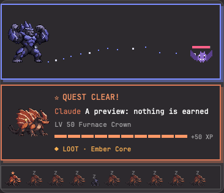

# Chroma Toast

Every agent is a pixel creature that grows with the tasks it finishes.
Notifications show as game cards with the creature of the agent that sent them: a finished task is a cleared quest worth XP for that agent.
A creature has ten forms, three skills that play on the card as an animation, and two items to wear, which drop from the mobs it fights.
Under the cards a lane shows a small creature for every agent that is open.

The picture shows two cards of the `preview` command (creatures at their last form), the upper one in the middle of its fight, and the lane.

## What you see

- A column of up to 3 cards (and over them up to 3 cards of `preview`), 360 px wide, in a floating block at the top edge, aligned to the end (right).
  Newest on top.
  The lane sits under the cards; with no cards and no open agent the block is empty, and so hidden.
- Each card: theme `background`, a 2 px frame in the agent color, padding 10 by 8, `selection` on hover.
  Behind it, shifted 4 px down and right, a block in the agent color at 40% opacity: a hard pixel-game shadow.
  - Left: the agent's creature in its current form, facing right.
    One square of the drawing is 1 px; every form fits a box of 68 by 68 px and is 53 to 68 px on its long side (Claude's first form is 55 by 25, its last 68 by 47).
    On a boss card it shakes 1 px left and right (`.loop("left", { from: -1, to: 1, period: 360 })`).
    A card that is not from an agent has a 20 px glyph in the kind color there instead, in a 24 px column.
  - Heading, 13 px extra bold, in the kind color; on an agent's card after a 12 px glyph of the kind.
    A cleared quest that made a level says `LEVEL UP!`, one that reached a new form `EVOLVED!`, and a golden one `GOLDEN QUEST!` (`EVOLVED!` comes first, then `GOLDEN QUEST!`).
    A combo adds its count: `QUEST CLEAR! x2`.
  - Line two, 12 px: the agent name in the agent color, bold (at most 30% of the card width), then the notification body, truncated.
    The title comes first unless it is Herdr's own "X needs you" / "X finished" for a known agent.
  - Line three, 11 px, `muted`: on an agent's card the level and the name of the form, `LV 12 Wedge Horn`.
  - A bar of 10 segments, 5 px high, 2 px apart.
    Lit segments are in the kind color, the rest in `selection`.
    After the bar, in 10 px `muted`: `+50 XP` on a cleared quest (`+60 XP` in a x2 combo), `click to open` on a boss card that has an action.
    On a `LEVEL UP!` or `EVOLVED!` card the bar blinks (`.loop("opacity", { from: 0.3, to: 1, period: 500 })`).
  - On a cleared quest of a creature that has a skill: a last line in the agent color, 11 px bold, `✦ Wedge Charge`.
    On the card that opened the skill it says `NEW SKILL · Wedge Charge`.
    On a card whose fight dropped an item the line names the item instead, in the item's color: `◆ LOOT · Ember Core`.
- Kinds:

  | Kind | Heading | Glyph | Color | Bar |
  |---|---|---|---|---|
  | needs you | `BOSS APPEARED!` | `☠` blinking | theme `blocked` | all lit |
  | done | `QUEST CLEAR!` | `★`/`☆` | theme `done` | XP inside the level (an agent's) |
  | error | `GAME OVER` | `✕` | `ansi1` | all lit |
  | warning | `DANGER AHEAD` | `▲`/`△` | `ansi3` | all lit |
  | notice | `NEW MESSAGE` | `✦`/`✧` | `accent` | all lit |

- XP: every cleared quest adds 50 XP to the agent that sent it.
  - Combo: a quest cleared by the same agent within 2 minutes of its last one is a combo.
    Each step adds 10 XP, up to 50 (x2 is 60 XP, x6 and on are 100 XP).
  - Golden: 1 cleared quest in 50 is golden and worth 3 times its XP.
- Forms and levels: a creature has 10 forms of 5 levels each, LV 1 to LV 50.
  500 XP make a level, so a form is 2,500 XP long; LV 50 starts at 24,500 XP and the count stops there.
- Skills: the 3rd, 5th and 7th form (LV 11, 21, 31) each open one of the creature's three skills.
  A skill is not a notification of its own.
  It plays once on the card of a cleared quest: 14 dots in the creature's color (2 px, every fourth 3 px and brighter) wait 120 ms at the creature and fly for 650 ms, each 20 ms after the one before, while the creature leans into it.
  Then they fly on to the mob of the fight (below) in 220 ms, each 10 ms after the one before, land a little apart and go out in 120 ms.
  The card that opened a skill plays that one; any other cleared quest plays one of the open skills at random.
  The first flight goes one of seven ways:

  | Way | The dots | The creature |
  |---|---|---|
  | `dash` | a trail left behind, in four bands | 8 px forward, 2 up |
  | `fan` | five lanes that spread forward | 1 px forward, 2 up |
  | `wave` | one wavy line forward | 1 px forward, 2 up |
  | `ward` | an arc in front | 1 px down |
  | `orbit` | a ring around it that turns | 1 px forward, 2 up |
  | `slam` | a ring that opens along the ground | 6 px up |
  | `eruption` | seven rays that rise from the feet | 4 px up |

- Fight: a cleared quest of an agent is a fight, played once on its card in the place of the text.
  A mob (slime, bat or mushroom, picked at random, 2 px a square) slides in from the right in 180 ms under an HP bar of 30 by 4 px, standing on the creature's ground line.
  At 760 ms it is hit: the bar empties in 300 ms and the mob blinks (a creature with no skill yet lunges 6 px at it).
  At 1,200 ms it is gone: four 4 px pieces in its color burst out and fade in 300 ms.
  At 2,300 ms the text is back (it fades in over 200 ms).
  On a card that plays a skill the mob is hit when the first dot lands, at 1,270 ms, and what follows is 510 ms later too (gone at 1,710 ms, text at 2,810 ms).
- Items: a creature has two items, and each must be found before it can be worn.
  1 fight in 20 the mob drops an item the agent has not found yet: it pops up where the mob stood (2 px a square), rises, then flies to the creature and fades.
  From LV 5 a found item can be worn.
  One is worn at a time, chosen in the gear (below), and it is drawn on the creature on the cards and in the party.
  An item changes nothing but the look.
- The creatures (the names of all 120 forms are in `creatures.js`):

  | Agent | Creature | First and last form | Skills (LV 11, 21, 31) | Items |
  |---|---|---|---|---|
  | Claude | `KILNBORN`, kiln salamander | Charcoal Hatchling, Furnace Crown | Wedge Charge (dash), Sail Vent (fan), Open Kiln (eruption) | Obsidian Pauldron, Ember Core |
  | Codex | `BASALT`, basalt gorilla | Blue Browstone, Three-Peak Crown | Basalt Pound (slam), Stone Brace (ward), Faultline (eruption) | Granite Bracer, Fault Core |
  | Gemini | `TWILIGHT`, twin-crested raptor | Twin Hatchling, Twilight Crowns | Twin Cut (dash), Crest Cross (fan), Double Dusk (orbit) | Plume Band, Twilight Pin |
  | Grok | `SILVERFANG`, silver-storm sabertooth | Ash Cub, Silverstorm King | Ivory Lunge (dash), Mane Shiver (fan), Silver Whiteout (orbit) | Graphite Collar, Frost Fang |
  | Kimi | `UNDERTOW`, deep-sea ribbon eel | Blue Fry, Bluestream Adult | Blue Coil (dash), Ribbon Current (wave), Abyss Spiral (orbit) | Deep Prism, Ribbon Clasp |
  | Cursor | `PALEWING`, alabaster blade owl | Folded Wings, Alabaster Crescent | Pinion Cut (dash), Alabaster Fan (fan), White Apex (eruption) | Ivory Feather, Slate Talon |
  | Copilot | `FERNBACK`, fern pangolin | Three-Leaf Scales, Fern Crown | Scale Ram (dash), Fern Curl (ward), Canopy Surge (eruption) | Fern Buckle, Moss Seed |
  | OpenCode | `SMELT`, amber forge beetle | Bronze Shell, Forge Glide | Spade Lift (slam), Amber Wing (fan), Forge Ascent (eruption) | Bronze Horn, Resin Beacon |
  | Amp | `REDHORN`, red-thunder bison | Red Tuft, Red-Thunder Lord | Red Horn (dash), Thunder Hoof (slam), Scarlet Fork (eruption) | Copper Hornband, Storm Shoe |
  | Kiro | `NIGHTHOOD`, amethyst cobra | First Violet Scales, Six-Spine Crown | Shadow Strike (dash), Double Hood (ward), Sixfold Eclipse (orbit) | Amethyst Pin, Shadow Loop |
  | Crush | `ROSEQUARTZ`, rose-quartz scorpion | Short Hook, Rose-Quartz Spire | Rose Pinch (dash), Thorn Drop (slam), Quartz Bloom (eruption) | Rose Clawcap, Thorn Charm |
  | Antigravity | `SOLARAY`, sun-sail manta | First Gold Line, Six Sun Sails | Sun Skim (dash), Sail Echo (wave), Zenith Descent (eruption) | Gold Keel, Sun Lens |

  goose, oh-my-pi and any agent that is not in the table use Grok's `SILVERFANG`, under their own name.
- The lane, under the cards: theme `background`, a 1 px `selection` border.
  One creature for every open agent, smaller than on a card and growing with its form (a first form is 14 px at the most on its long side, a last form 34 px), in the form of its XP.
  Agents that need you stand first, then done, working and idle; in each group the one that changed last comes first.
  As many as fit in the card width; the rest are left out.
  Over each, in 10 px bold in the status color: `!` blinking (needs you), `★` (done), `.` `..` `...` (working), `z` `zZ` `zZz` (idle).
  A working creature bobs 1 px, one that needs you shakes 1 px, an idle one is at 55% opacity.
- The menu, the party and the gear take the cards' place while open; the lane stays.
  Each is a box as wide as a card: theme `background`, a 2 px `accent` frame, the title in 13 px extra bold and a line of key hints in 10 px `muted`.
  - Menu (`CHROMA`): two rows, `P` party and `E` gear.
  - Party: up to 6 agents that have XP, most XP first.
    Each row: the creature, wearing its item, then the agent name, `KILNBORN · kiln salamander`, `LV 12 Wedge Horn` and the XP bar in the agent color.
  - Gear: one agent that has XP, with the same row.
    Under it its two items (a `1` or `2` key cap, the item drawn at 2 px a square, its name, then `WORN`, `NOT FOUND` until it has dropped, or `LV 5` before that level) and its three skills with the level that opens each.
    Rows that are not open yet are at 45% opacity.
- Agent colors: the same as in the other examples (the `AGENTS` table in `core.js`).
  An agent that is not in that table is framed in the theme `accent`; so is a non-agent notification, which shows `Herdr`.
- Monospace font: the first installed of JetBrains Mono, SF Mono, Menlo, Cascadia Mono, Consolas, DejaVu Sans Mono; else the app font.
- A narrow spot, such as a sidebar: the floating block can pass a card width and leave the lane out, `"content": { "mod": "toast-chroma", "props": { "width": 228, "lane": false } }` (default 360 and `true`; a width under 200 counts as 200).
  On a narrow card the body and the longest form names are cut with `…`.

## How it behaves

- Kind, in this order:
  1. The title is Herdr's own "X needs you" and X is an agent: a boss card.
     Herdr posts it with level `error`, so the title is read before the level.
  2. The title is Herdr's own "X finished" and X is an agent: a cleared quest (Herdr posts it with level `info`).
  3. Otherwise by level: `error`, `warning`, `success` (a cleared quest), anything else a notice card.
- `working`, `idle`: no card (Herdr posts none); the lane shows them.
- Which agent, in this order: the terminal the notification's action focuses (`agents()` by address: its reported `app` and program key), the icon file name, then the program named in Herdr's own "X needs you" / "X finished" title.
- XP is added when a cleared quest of an agent arrives, whether or not its card is still showing, and is kept per agent in `shared("toast-chroma.xp")`, so it survives restarts.
  A cleared quest that is not from an agent earns nothing.
  The demo's cleared quest counts too.
- Running combos are kept in `shared("toast-chroma.combo")`, the items each agent has found in `shared("toast-chroma.bag")` and the one it wears in `shared("toast-chroma.gear")`.
- The drop is rolled when the cleared quest arrives, like the XP, so an item is found even when its card is never drawn.
- A cleared quest's card keeps the XP total of the moment it arrived, so an older card still shows the form and the level it had then.
  Any other card shows the agent as it is now.
- A skill and a fight play the first time their card is drawn.
  A card that is more than 3 s old by then (Herdr restarted with a queue) plays nothing.
- A new card always shows.
  It replaces older cards about the same terminal, so each agent shows its latest news once.
  More than 3 cards: the oldest card that is not a boss card goes first; when all are boss cards, the oldest of those.
- Click a card: run its action (Herdr's own go to the agent) and remove the card.
  A card stays until then: nothing leaves on a timer, and a notification's own `timeout` is not used.
- Click a creature in the lane: go to that agent (`agent.focus` with its terminal).
- `herdr-app do toast-chroma.menu` shows the menu and takes the keyboard.
  P opens the party and E the gear; in the party E goes to the gear, in the gear P goes to the party.
  In the gear, left and right change the agent, and 1 and 2 put that item on or take it off (so does a click on its row); nothing happens before LV 5 or with an item that is not found.
  Any other key closes what is open and gives the keyboard back to the pane it came from; so does a click on the box, and a click elsewhere closes it within about a second.
  Chords with cmd, ctrl or alt are let through.
  Bind it to a key in the `global` section of `keys.json`: `"cmd-shift-j": "toast-chroma.menu"`.
  Then press cmd-shift-j, let go, and press P or E.
- `herdr-app do toast-chroma.party` and `toast-chroma.gear` open them directly; the same command again closes.
- `herdr-app do toast-chroma.demo` posts three sample cards: Claude boss, Codex quest clear, Gemini game over.
  They stay like any other; click them away.
- `herdr-app do toast-chroma.preview` shows a cleared quest of a creature at its last form, with a skill, a fight and the drop of the item it wears, for the next agent of the table each time.
  It earns nothing, finds nothing, is not put in the queue, and leaves after 10 s or on a click.
- `herdr-app do toast-chroma.pick` numbers the cards (1 to 9) and takes the keyboard:
  a digit opens that card as a click would, `pick` again or Enter opens the top one; any other key gives the keyboard back to the pane it came from.
  Bind it the same way: `"cmd-j": "toast-chroma.pick"`.

## Built from

- One mod, `mods/toast-chroma/`, 16 files:
  - `mod.json` = `{ "place": "none" }`.
  - `main.js`: draws the cards, the lane, the party and the gear, plays the skills and the fights, keeps the XP and the found items.
  - `core.js`: the agent table, agent and kind detection, the card queue, the picker.
    It is the same file in every herdr-agent-toast mod.
  - `creatures.js`: per agent the creature's name and kind, its sheet, ten forms, three skills, two items.
  - 12 sheets, one PNG per creature (`claude.png` ... `antigravity.png`), about 370 KB together.
- It is used in two places in the person's layout:
  - Root: `"toast": "toast-chroma"`.
    Herdr opens a copy for every notification with props `{title, body, level, icon, action, timeout, overlay}`.
    A copy with `overlay` and a string `title` adds a card to `shared("toast-chroma.queue")` (newest first, 3 kept, `until: 0` so it never expires), adds the XP for an agent's cleared quest, picks the skill the card plays and the mob it fights, rolls the drop, and closes itself with `closeOverlay`.
  - A floating block on the node that holds the terminals: `{ "id": "toast-chroma", "content": { "mod": "toast-chroma" }, "edge": "top", "align": "end" }`.
    That copy draws, drops expired `preview` cards once a second, and waits on `nextCommand()` for `demo`, `pick`, `menu`, `party`, `gear` and `preview`.
- A sheet is 2 pixels a square.
  Its first row holds the ten forms at card size, its second row at lane size, one empty square around each; `creatures.js` says where each sits (`box`, `small`, in squares).
- Drawing a form: a box of the form's size with `overflow_hidden`, and in it the whole sheet as an `image()`, `absolute`, moved left and up by the form's place.
  The image path is from Herdr's config folder: `mods/toast-chroma/claude.png`.
  One square is drawn `1 / zoom` wide, with the zoom from `settings()`.
- An item is drawn as blocks (`SHAPES` in `main.js`: plate, core, crest, ring) in the item's color, on the square `pins` names for that form.
- The skill's motion is Herdr's own: each dot has an `id` and is drawn at its start, then drawn again at the end of its way and once more on the mob, with `.transition("left", ...)`, `.transition("top", ...)` and `.transition("opacity", ...)`.
  Three timers (`cx.timer.after`) step a card through waiting, flying, striking and over.
- A mob is drawn as blocks from rows of letters (`MOBS` in `main.js`), like an item.
  The fight moves the same way: six timers step it, and the mob, its HP bar, the pieces and the dropped item each have an `id` and a `transition` on `left`, `top`, `width` or `opacity`.
- The menu, the party and the gear share the picker's focus handle (`track_focus`, `on_key_down`).
- `herdr` functions: `props`, `closeOverlay`, `shared`, `setShared`, `agents`, `focused`, `run`, `theme`, `fonts`, `settings`, `notify`, `nextCommand`.
- No network, no `exec`, no files written; the only files read are the sheets.

## Watch out

- The drawings cannot be rebuilt from this text: copy all 16 files.
  `creatures.js` and the sheets belong together, so do not edit one without the other.
- The sheet path names the mod folder (`ART` in `main.js`); change it when the folder gets another name.
- Copying the folder alone changes nothing.
  Both layout entries are needed: without the root `toast`, Herdr's default toast shows; without the floating block, cards are queued but never drawn.
- Write `mod.json` (`place: none`) before the folder appears under `mods/`, or Herdr may dock it as a side panel first.
- Clone a shipped layout before editing it; edit the person's own layout otherwise.
- Do not sort by level first: Herdr's needs-you notification has level `error` and would show as a game-over card.
- `shared()` is saved to disk, so the cards are still there after Herdr restarts.
- Add the XP in the copy that receives the notification, not in the copy that draws, or it is counted on every redraw.
- The creatures face right, so a skill has the card to fly across; with the block on the left edge of the window they still face right.
- The menu takes the keyboard, like `pick`: while it shows, keys do not reach the terminal.
- A floating block is cut off at the edges of the node it floats on; in a narrow node pass a `width` that fits.
- Agent colors are fixed hex values; on a light theme the pale ones (Cursor, Antigravity, oh-my-pi) are faint.
- Tested with Herdr app 0.1.17 on macOS, on a 2x screen at zoom 1.

## Done when

1. `herdr-app check ~/.config/herdr-app/mods/toast-chroma` passes.
2. `herdr-app status` shows no errors and lists `toast-chroma` under `floats`.
3. `herdr-app do toast-chroma.demo` shows three cards top right: Claude (orange frame, `BOSS APPEARED!`, `LV 1 Charcoal Hatchling`), Codex (blue frame, `QUEST CLEAR!`, `+50 XP`, `LV 1 Blue Browstone`), Gemini (purple frame, `GAME OVER`, `LV 1 Twin Hatchling`), each with its creature on the left.
   1 of the 10 parts of the Codex bar is lit (50 of the 500 XP of LV 1).
   1 time in 50 that card is golden: `GOLDEN QUEST!`, `+150 XP`, 3 parts lit.
4. Running the demo again within 2 minutes makes the Codex card say `QUEST CLEAR! x2` and `+60 XP`.
   The card that takes an agent to 500 XP says `LEVEL UP!`, shows `LV 2` and blinks its bar.
5. `herdr-app do toast-chroma.preview` shows a `LV 50` card whose creature wears an item: dots fly from it once and on to a mob that came in from the right, the mob bursts, an item pops out of it, and after about 3 s the text shows with a last line `◆ LOOT ·` and the item's name.
6. With an agent open, the lane under the cards shows its small creature, and a click on it goes to that agent.
7. With `"cmd-shift-j": "toast-chroma.menu"` in the `global` section of `keys.json`, cmd-shift-j shows the `CHROMA` box; P shows the party, E the gear, Escape closes it and the keyboard goes back to the terminal it was on.
