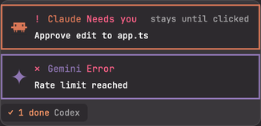

# Focus Toast

Only what needs your hands gets a card: an agent that needs you, and an error.
Those cards stay in the top-right corner of the window until you click them.
Finished tasks and other news get no card; they are counted in a small chip under the cards.
Each card is framed in the color of the agent that sent it (Claude, Codex, Gemini, Cursor, ...) with that agent's icon.

## What you see

- A column of up to 3 cards, 360 px wide, 6 px apart, in a floating block at the top edge, aligned to the end (right), with the chip under them on the left.
  Newest card on top.
  The block is empty, and so hidden, when there are no cards and nothing was counted.
- Each card: theme `background`, a 2 px frame in the agent color, padding 12 by 8, `selection` on hover.
  - Left: the agent icon, 22 px.
    Full-color icons are drawn as images; one-color icons are drawn in the agent color.
    No icon: a 22 px square in the frame color.
  - Heading row, 13 px bold: a glyph in the kind color, the agent name in the agent color (at most 40% of the card width), then the kind label in the kind color.
    A needs-you card adds `stays until clicked` on the right, 12 px, in `muted`; it is cut short first when the row is full.
  - Line two, 12 px: the notification body, truncated.
    The title comes first unless it is Herdr's own "X needs you" / "X finished" for a known agent, or just the agent's name.
- Kinds that get a card: needs you (`!` blinking, theme `blocked`, label `Needs you`) and error (`✕`, `ansi1`, label `Error`).
- The chip: 12 px text on theme `background`, rounded 6, padding 10 by 3, `selection` on hover, as wide as its words and a card at the most.
  - `✓ 2 done` in bold, in the theme `done` color: how many tasks finished.
  - The agents that finished, newest first, 3 at the most, in `muted`: `Codex, Claude`.
  - `+1 more` in `muted`: how many warnings and notices came in.
    With nothing finished it reads `1 more`.
- Agent colors: Claude `#D97757`, Codex `#7B8CFF`, Gemini `#8E75B2`, Cursor `#D6D8DB`, Copilot `#3FB950`, OpenCode `#F5A742`, Amp `#F34E3F`, Kiro `#9046FF`, Grok `#A0A4AB`, Kimi `#1783FF`, Crush `#FF6DAA`, Antigravity `#FFE432`, goose `#2EC4B6`, oh-my-pi `#A3E635`.
  Other agents use Herdr's own name and icon for them, framed in the theme `accent`.
  Non-agent notifications show `Herdr`.
- Monospace font: the first installed of JetBrains Mono, SF Mono, Menlo, Cascadia Mono, Consolas, DejaVu Sans Mono; else the app font.
- A narrow spot, such as a sidebar: the floating block can pass a card width, `"content": { "mod": "toast-focus", "props": { "width": 228 } }` (default 360; a value under 180 counts as 180).
  Under 300 px the `stays until clicked` note moves to a row of its own, under line two.

## How it behaves

- Kind, in this order:
  1. The title is Herdr's own "X needs you" and X is an agent: needs you.
     Herdr posts it with level `error`, so the title is read before the level.
     Herdr does not say whether the agent wants an approval or an answer, so both look the same.
  2. The title is Herdr's own "X finished" and X is an agent: done (Herdr posts it with level `info`).
  3. Otherwise by level: `error`, `warning`, `success` (done), anything else a notice.
- Needs you and error: a card with no end time.
  It leaves when it is clicked, when newer news comes from the same terminal, or when a fourth card needs the room.
- Done, warning and notice: no card.
  Done adds 1 to the chip's `done` count and puts the agent's name first in the chip; a warning or a notice adds 1 to `more`.
  If the notification is about a terminal that has a card waiting, that card is taken away: the agent has moved on.
- `working`, `idle`: nothing (Herdr posts none).
- Which agent, in this order: the terminal the notification's action focuses (`agents()` by address: its reported `app` and program key), the icon file name, then the program named in Herdr's own "X needs you" / "X finished" title.
  A title is read only on notifications whose action is `agent.focus`, and an icon only from Herdr's `icons/` folder, so "Cursor position saved" or "Amp server finished" from another mod stays a Herdr notification.
  An agent that is not in the table and whose terminal is gone keeps the name from the title.
- A new card always shows.
  It replaces an older card about the same terminal, so each agent shows its latest news once.
  More than 3 cards: the oldest error card goes first; when all are needs-you cards, the oldest of those.
- Click a card: remove the card and run its action (Herdr's own go to the agent).
- Click the chip: the counts go back to zero and the chip hides.
- The cards and the counts are in shared state, so they are still there after Herdr restarts.
- `herdr-app do toast-focus.demo` posts three sample notifications: a Claude needs-you card, a Gemini error card, and one finished Codex task on the chip.
  The sample cards stay like any other, so running it again adds to what is there; click them away.
- `herdr-app do toast-focus.pick` numbers the cards (1 to 9) and takes the keyboard:
  a digit opens that card as a click would, `pick` again or Enter opens the top one; any other key gives the keyboard back to the pane it came from.
  Chords with cmd, ctrl or alt are let through, so the key bound to `pick` still works.
  A click elsewhere ends it too. Bind it to a key in `keys.json` to use it: `"global": { "cmd-j": "toast-focus.pick" }`.

## Built from

- One mod, `mods/toast-focus/`: `mod.json` = `{ "place": "none" }`, `main.js` (draws the cards and the chip, keeps the counts) and `core.js` (the agent table, agent and kind detection, the card queue).
  It is used in two places in the person's layout:
  - Root: `"toast": "toast-focus"`.
    Herdr opens a copy for every notification with props `{title, body, level, icon, action, timeout, overlay}`.
    A copy with `overlay` and a string `title` either adds a card to `shared("toast-focus.queue")` (newest first, 3 kept, `until: 0` so it never expires) or updates `shared("toast-focus.quiet")` = `{ done, more, names }`, and closes itself with `closeOverlay`.
  - A floating block on the node that holds the terminals: `{ "id": "toast-focus", "content": { "mod": "toast-focus" }, "edge": "top", "align": "end" }`.
    That copy draws the queue and the chip, and waits on `nextCommand()` for `demo` and `pick`.
    It needs no timer: `setShared` redraws every mod, and nothing here expires.
- `herdr` functions: `props`, `closeOverlay`, `shared`, `setShared`, `agents`, `focused`, `run`, `theme`, `fonts`, `notify`, `nextCommand`.
- `core.js` is the same file in every herdr-agent-toast mod; a build from scratch can keep it in `main.js`.
- Icons are Herdr's own `icons/*.svg`; none ship with the mod.
  No network, no `exec`, no files read or written.

## Watch out

- Copying the folder alone changes nothing.
  Both layout entries are needed: without the root `toast`, Herdr's default toast shows; without the floating block, cards are queued but never drawn.
- Write `mod.json` (`place: none`) before the folder appears under `mods/`, or Herdr may dock it as a side panel first.
- Clone a shipped layout before editing it; edit the person's own layout otherwise.
- Do not sort by level first: Herdr's needs-you notification has level `error` and would show as an error card.
- Count in the copy that receives the notification, not in the copy that draws, or a notification is counted on every redraw.
- A card does not know that you answered the agent in its terminal.
  It stays until you click it or that agent posts again.
- A notification's own `timeout` is not used: cards stay, and counted notifications never show.
- Cards and counts outlive a switch to another example: come back to this one and the old ones show again until clicked.
- Agent colors are fixed hex values; on a light theme the pale ones (Cursor, Antigravity, oh-my-pi) are faint.
- Tested with Herdr app 0.1.16 on macOS (v1.0.0 and earlier: 0.1.15).

## Done when

1. `herdr-app check ~/.config/herdr-app/mods/toast-focus` passes.
2. `herdr-app status` shows no errors and lists `toast-focus` under `floats`.
3. `herdr-app do toast-focus.demo` shows two cards top right, Claude (orange frame, Needs you) and Gemini (purple frame, Error), and a chip reading `✓ 1 done Codex`.
4. A minute later the two cards are still there.
5. Clicking a card removes it; clicking the chip hides it; with both cards and the chip gone the block hides.
6. An agent that finishes while you look elsewhere shows no card: the chip's count goes up by one and names the agent.
7. With `"cmd-j": "toast-focus.pick"` in the `global` section of `keys.json`, cmd-j after the demo puts 1 and 2 on the demo cards.
   Escape takes the numbers away and the keyboard goes back to the terminal it was on.
