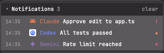

# History Toast

Notifications that do not get lost: every one becomes a row in a list that is kept.
A new notification opens the list in the top-right corner of the window for 10 seconds; then the list folds into a small badge with the number of new rows.
Click the badge to read the list again, and a row to go to that agent.
Each row has the icon and the color of the agent that sent it (Claude, Codex, Gemini, Cursor, ...).

## What you see

- One floating block at the top edge, aligned to the end (right): the open list, or the badge.
  The block is empty, and so hidden, when the list has no rows.
- The list: 360 px wide, theme `background`, a 1 px frame in theme `border`, 12 px text.
  - Heading row, padding 10 by 5, a 1 px line under it: `▾` in `muted`, `Notifications` in bold, the number of rows in `muted`; on the right `clear` in `muted` (`foreground` on hover).
  - Rows, 26 px high, padding 10, 8 px between the parts, newest on top.
    - The time, 11 px, in `muted`, 44 px wide: `14:02` for today, `Nov 15` for an earlier day.
    - The agent icon, 16 px.
      Full-color icons are drawn as images; one-color icons are drawn in the agent color.
      No icon: a 16 px square in the agent color.
    - The agent name in bold, in the agent color (at most 30% of the list width).
    - The notification body, truncated.
      The title comes first unless it is Herdr's own "X needs you" / "X finished" for a known agent, or just the agent's name.
    - A glyph for the kind, in bold, in the kind color.
  - A new row has the theme `selection` background; a row under the pointer has `hover`.
  - 8 rows show; with more, the rows scroll.
- Kinds: needs you (`!`, theme `blocked`), done (`★`, `done`), error (`✕`, `ansi1`), warning (`▲`, `ansi3`), notice (`✦`, `accent`).
- The badge: 22 px high, rounded 6, theme `background`, `selection` on hover.
  `≡` in `muted`, then the number of new rows, 11 px bold, in a pill in the theme `blocked` color.
  With no new rows it is just `≡`.
- Agent colors: Claude `#D97757`, Codex `#7B8CFF`, Gemini `#8E75B2`, Cursor `#D6D8DB`, Copilot `#3FB950`, OpenCode `#F5A742`, Amp `#F34E3F`, Kiro `#9046FF`, Grok `#A0A4AB`, Kimi `#1783FF`, Crush `#FF6DAA`, Antigravity `#FFE432`, goose `#2EC4B6`, oh-my-pi `#A3E635`.
  Other agents use Herdr's own name and icon for them, in the theme `accent`.
  Non-agent notifications show `Herdr`.
- Monospace font: the first installed of JetBrains Mono, SF Mono, Menlo, Cascadia Mono, Consolas, DejaVu Sans Mono; else the app font.
- A narrow spot, such as a sidebar: the floating block can pass a list width, `"content": { "mod": "toast-history", "props": { "width": 228 } }` (default 360; a value under 180 counts as 180).
  Under 300 px the rows have no time.

## How it behaves

- Kind, in this order:
  1. The title is Herdr's own "X needs you" and X is an agent: needs you.
     Herdr posts it with level `error`, so the title is read before the level.
  2. The title is Herdr's own "X finished" and X is an agent: done (Herdr posts it with level `info`).
  3. Otherwise by level: `error`, `warning`, `success` (done), anything else a notice.
- `working`, `idle`: nothing (Herdr posts none).
- Which agent, in this order: the terminal the notification's action focuses (`agents()` by address: its reported `app` and program key), the icon file name, then the program named in Herdr's own "X needs you" / "X finished" title.
  A title is read only on notifications whose action is `agent.focus`, and an icon only from Herdr's `icons/` folder, so "Cursor position saved" or "Amp server finished" from another mod stays a Herdr notification.
  An agent that is not in the table and whose terminal is gone keeps the name from the title.
- Every notification becomes a row, of any kind.
  The newest 20 are kept; a row is never replaced by a later one from the same agent.
- A new notification opens the list for 10 s, or for the notification's own `timeout` when it has one.
  A list that is already open is never folded sooner by a later notification.
  Then the list folds into the badge.
  It does not fold while the pointer is on it.
- New rows: the ones that came after you last folded the list or clicked a row.
- Click the badge: the list opens and stays open until you fold it.
- Click the heading: the list folds, and no row is new any more.
- Click a row: run the notification's action (Herdr's own go to the agent).
  The row stays, and no row is new any more.
- Click `clear`: every row goes, and the block hides until the next notification.
- The rows are in shared state, so they are still there after Herdr restarts.
- `herdr-app do toast-history.demo` posts three sample notifications: Claude needs you, Codex finished, a Gemini error.

## Built from

- One mod, `mods/toast-history/`: `mod.json` = `{ "place": "none" }`, `main.js` (keeps the log, draws the list and the badge) and `core.js` (the agent table, agent and kind detection).
  It is used in two places in the person's layout:
  - Root: `"toast": "toast-history"`.
    Herdr opens a copy for every notification with props `{title, body, level, icon, action, timeout, overlay}`.
    A copy with `overlay` and a string `title` puts a row first in `shared("toast-history.log")` (20 kept, each with the time it came, `at`), moves `shared("toast-history.peek")` (the time until which the list stays open) forward, and closes itself with `closeOverlay`.
  - A floating block on the node that holds the terminals: `{ "id": "toast-history", "content": { "mod": "toast-history" }, "edge": "top", "align": "end" }`.
    That copy draws the list while it is opened by a click, or `peek` is ahead, or the pointer is still on an open list (`placement().hovered`); otherwise the badge.
    It waits on `nextCommand()` for `demo`.
- `shared("toast-history.seen")`: the time of the last fold or row click.
  A row is new when its `at` is later.
- Whether the list was opened by a click is kept in the view, not in shared state: after a restart the list is folded.
- A 1 s timer looks whether it is time to fold, and redraws only then.
- The rows scroll with `.max_h(8 * 26).min_h(0).overflow_y_scroll()`.
- `herdr` functions: `props`, `closeOverlay`, `shared`, `setShared`, `agents`, `run`, `theme`, `fonts`, `notify`, `nextCommand`, `placement`.
- `core.js` is the same file in every herdr-agent-toast mod; a build from scratch can keep it in `main.js`.
  Its card queue is not used here: a queue lets a card go when its time is up, and a history keeps it.
- Icons are Herdr's own `icons/*.svg`; none ship with the mod.
  No network, no `exec`, no files read or written.

## Watch out

- Copying the folder alone changes nothing.
  Both layout entries are needed: without the root `toast`, Herdr's default toast shows; without the floating block, rows are kept but never drawn.
- Write `mod.json` (`place: none`) before the folder appears under `mods/`, or Herdr may dock it as a side panel first.
- Clone a shipped layout before editing it; edit the person's own layout otherwise.
- Do not sort by level first: Herdr's needs-you notification has level `error` and would show as an error row.
- Add the row in the copy that receives the notification, not in the copy that draws, or a notification is added on every redraw.
- Do not track the pointer with `on_hover` on the list: in testing it missed the pointer leaving, and the list stayed open.
  `placement().hovered` is Herdr's own report for the floating block.
- Hold the list open under the pointer only when it is already open, or pointing at the badge opens it and a click on the heading cannot fold it.
- The titles and bodies of the last 20 notifications are in Herdr's shared state file on disk until `clear` is clicked.
  Taking the mod out does not remove them.
- Rows outlive a switch to another example: come back to this one and they are still listed.
- Agent colors are fixed hex values; on a light theme the pale ones (Cursor, Antigravity, oh-my-pi) are faint.
- Tested with Herdr app 0.1.15 and 0.1.16 on macOS.

## Done when

1. `herdr-app check ~/.config/herdr-app/mods/toast-history` passes.
2. `herdr-app status` shows no errors and lists `toast-history` under `floats`.
3. With an empty list, `herdr-app do toast-history.demo` opens the list top right with three rows: Claude (`!`), Codex (`★`), Gemini (`✕`), all three on the `selection` background.
4. About 10 s later, with the pointer elsewhere, the list folds into a badge reading `≡ 3`.
5. Clicking the badge opens the list; clicking the heading folds it, and the badge reads `≡`.
6. Clicking `clear` hides the block.
7. An agent that finishes adds a row and opens the list for 10 s; clicking its row goes to that agent.
