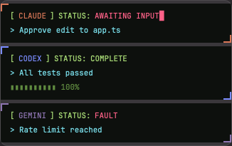

# HUD Toast

Notifications show as readouts on a control-room screen, stacked in the top-right corner of the window.
Black panels, green monospace text, and an uppercase status code: `AWAITING INPUT`, `COMPLETE`, `FAULT`.
Corner brackets are in the color of the agent that sent it (Claude, Codex, Gemini, Cursor, ...), and a cursor blinks when an agent needs you.

## What you see

- A column of up to 3 cards, 360 px wide, 6 px apart, in a floating block at the top edge, aligned to the end (right).
  Newest on top.
  The block is empty, and so hidden, when there are no cards.
- Each card: a black panel `#0D100D` on every theme, `#1A211A` on hover, padding 14 by 10, 12 px text.
  - Two corner brackets in the agent color, 12 px, 2 px thick: top left and bottom right.
  - Heading row: `[` `CLAUDE` `]` `STATUS:` `AWAITING INPUT`.
    The brackets and `STATUS:` in green `#A9DC76`; the agent name in capitals, bold, in the agent color (at most 40% of the card width); the status code in bold, in the kind color.
    A needs-you card ends with a `█` cursor that blinks every 500 ms.
  - Line two: `>` and the notification body, in cyan `#78DCE8`, truncated.
    The title comes first unless it is Herdr's own "X needs you" / "X finished" for a known agent, or just the agent's name.
  - A done card adds a third line: `▮▮▮▮▮▮▮▮▮▮ 100%` in dim green `#5F8A3F`.
- Status codes: needs you `AWAITING INPUT` (`#FF6188`), done `COMPLETE` (`#A9DC76`), error `FAULT` (`#FF6188`), warning `CAUTION` (`#FFD866`), notice `NOTICE` (`#78DCE8`).
- Agent colors: Claude `#D97757`, Codex `#7B8CFF`, Gemini `#8E75B2`, Cursor `#D6D8DB`, Copilot `#3FB950`, OpenCode `#F5A742`, Amp `#F34E3F`, Kiro `#9046FF`, Grok `#A0A4AB`, Kimi `#1783FF`, Crush `#FF6DAA`, Antigravity `#FFE432`.
  Other agents use Herdr's own name for them, with green brackets.
  Non-agent notifications show `HERDR`.
- No icons: the name in the heading says who it is.
- Monospace font: the first installed of JetBrains Mono, SF Mono, Menlo, Cascadia Mono, Consolas, DejaVu Sans Mono; else the app font.
- A narrow spot, such as a sidebar: the floating block can pass a card width, `"content": { "mod": "toast-hud", "props": { "width": 228 } }` (default 360; a value under 180 counts as 180).
  Under 300 px the heading drops `STATUS:`.

## How it behaves

- Kind, in this order:
  1. The title is Herdr's own "X needs you" and X is an agent: needs you.
     Herdr posts it with level `error`, so the title is read before the level.
     Herdr does not say whether the agent wants an approval or an answer, so both look the same.
  2. The title is Herdr's own "X finished" and X is an agent: done (Herdr posts it with level `info`).
  3. Otherwise by level: `error`, `warning`, `success` (done), anything else a notice.
- `working`, `idle`: no card (Herdr posts none).
- Which agent, in this order: the terminal the notification's action focuses (`agents()` by address: its reported `app` and program key), the icon file name, then the program named in Herdr's own "X needs you" / "X finished" title.
  A title is read only on notifications whose action is `agent.focus`, and an icon only from Herdr's `icons/` folder, so "Cursor position saved" or "Amp server finished" from another mod stays a Herdr card.
  An agent that is not in the table and whose terminal is gone keeps the name from the title.
- A new card always shows.
  It replaces older cards about the same terminal, so each agent shows its latest news once.
  More than 3 cards: the oldest card that is not a needs-you card goes first; when all are needs-you cards, the oldest of those.
- Click a card: run its action (Herdr's own go to the agent) and remove the card.
  Cards also leave after their timeout (default 10 s).
- Expired cards never show, even after Herdr restarts with an old queue.
- `herdr-app do toast-hud.demo` posts three sample cards: Claude `AWAITING INPUT`, Codex `COMPLETE`, Gemini `FAULT`.

## Built from

- One mod, `mods/toast-hud/`: `mod.json` = `{ "place": "none" }`, `main.js` (draws the cards) and `core.js` (the agent table, agent and kind detection, the card queue).
  It is used in two places in the person's layout:
  - Root: `"toast": "toast-hud"`.
    Herdr opens a copy for every notification with props `{title, body, level, icon, action, timeout, overlay}`.
    A copy with `overlay` and a string `title` adds a card to `shared("toast-hud.queue")` (newest first, 3 kept) and closes itself with `closeOverlay`.
  - A floating block on the node that holds the terminals: `{ "id": "toast-hud", "content": { "mod": "toast-hud" }, "edge": "top", "align": "end" }`.
    That copy draws the queue, drops expired cards once a second, and waits on `nextCommand()` for `demo`.
- The corner brackets are two 12 px `absolute` boxes with only two sides of a border: `border_t(2).border_l(2)` and `border_b(2).border_r(2)`.
- The blinking cursor is `.frames(["█", " "], 500)`.
- Capitals are made in JavaScript with `toUpperCase()`; the body keeps its own case.
- `herdr` functions: `props`, `closeOverlay`, `shared`, `setShared`, `agents`, `run`, `fonts`, `notify`, `nextCommand`.
  No `theme()`: the screen colors are fixed.
- `core.js` is the same file in every herdr-agent-toast mod; a build from scratch can keep it in `main.js`.
- No network, no `exec`, no files read or written.

## Watch out

- Copying the folder alone changes nothing.
  Both layout entries are needed: without the root `toast`, Herdr's default toast shows; without the floating block, cards are queued but never drawn.
- Write `mod.json` (`place: none`) before the folder appears under `mods/`, or Herdr may dock it as a side panel first.
- Clone a shipped layout before editing it; edit the person's own layout otherwise.
- Do not sort by level first: Herdr's needs-you notification has level `error` and would show as `FAULT`.
- `shared()` is saved to disk, so the queue survives a restart: filter expired cards whenever you read it.
- Float the mod once.
  In testing, with two floating blocks of `toast-hud`, one `demo` posted its three samples twice.
- The panels stay black on a light theme on purpose; they do not follow the theme.
- Tested with Herdr app 0.1.15 on macOS.

## Done when

1. `herdr-app check ~/.config/herdr-app/mods/toast-hud` passes.
2. `herdr-app status` shows no errors and lists `toast-hud` under `floats`.
3. `herdr-app do toast-hud.demo` shows three black cards top right:
   `[ CLAUDE ] STATUS: AWAITING INPUT█` with orange brackets and a blinking cursor, `[ CODEX ] STATUS: COMPLETE` with blue brackets and the `100%` line, `[ GEMINI ] STATUS: FAULT` with purple brackets.
4. An agent that finishes while you look elsewhere shows a `COMPLETE` card with its color; clicking it goes to that agent.
5. After 10 s untouched, cards disappear and the block hides.
