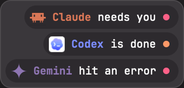

# Minimal Toast

Notifications show as thin pills stacked in the top-right corner of the window instead of the bottom toast.
Each pill is one line: the agent's icon, its name in its color (Claude, Codex, Gemini, Cursor, ...), what happened, and a dot in the color of the kind.
Point at a pill to read the rest.
Of the examples in this repo it covers the least screen.

## What you see

- A column of up to 3 pills, 4 px apart, in a floating block at the top edge, aligned to the end (right).
  Newest on top.
  The block is empty, and so hidden, when there are no pills.
- Each pill: 26 px high, fully rounded, theme `background`, `selection` on hover, padding 6 on the left and 10 on the right.
  A pill is as wide as its words, 360 px at the most.
  - The agent icon, 18 px.
    Full-color icons are drawn as images; one-color icons are drawn in the agent color.
    No icon: an 18 px circle in the agent color.
  - The agent name, 12 px bold, in the agent color (at most 40% of the widest a pill may be).
  - What happened, 12 px, in `foreground`: `needs you`, `is done`, `hit an error`, `has a warning`, `has news`.
    These words are cut short first when a pill is at its widest.
  - A 7 px dot in the kind color: needs you theme `blocked`, done theme `done`, error `ansi1`, warning `ansi3`, notice `accent`.
    Only the needs-you dot pulses.
- While the pointer is on a pill, the notification's text shows before the dot, in `muted`, truncated.
  The title comes first unless it is Herdr's own "X needs you" / "X finished" for a known agent, or just the agent's name.
- Pills differ in width, so they line up on the side the block sits on: left on the left edge, right on the right edge, and by `align` (`start`, `center`, `end`) on the top and bottom edges.
  The column has 5 px on each side, the same as Herdr's frame leaves above and below.
- Agent colors: Claude `#D97757`, Codex `#7B8CFF`, Gemini `#8E75B2`, Cursor `#D6D8DB`, Copilot `#3FB950`, OpenCode `#F5A742`, Amp `#F34E3F`, Kiro `#9046FF`, Grok `#A0A4AB`, Kimi `#1783FF`, Crush `#FF6DAA`, Antigravity `#FFE432`, goose `#2EC4B6`, oh-my-pi `#A3E635`.
  Other agents use Herdr's own name and icon for them, in the theme `accent`.
  Non-agent notifications show `Herdr`.
- The app font (`ui_font` in Herdr's settings); no monospace font is picked.
  The preview was taken with a monospace app font.
- A narrow spot, such as a sidebar: the floating block can set the widest a pill may be, `"content": { "mod": "toast-minimal", "props": { "width": 228 } }` (default 360; a value under 180 counts as 180).

## How it behaves

- Kind, in this order:
  1. The title is Herdr's own "X needs you" and X is an agent: needs you.
     Herdr posts it with level `error`, so the title is read before the level.
     Herdr does not say whether the agent wants an approval or an answer, so both look the same.
  2. The title is Herdr's own "X finished" and X is an agent: done (Herdr posts it with level `info`).
  3. Otherwise by level: `error`, `warning`, `success` (done), anything else a notice.
- `working`, `idle`: no pill (Herdr posts none).
- Which agent, in this order: the terminal the notification's action focuses (`agents()` by address: its reported `app` and program key), the icon file name, then the program named in Herdr's own "X needs you" / "X finished" title.
  A title is read only on notifications whose action is `agent.focus`, and an icon only from Herdr's `icons/` folder, so "Cursor position saved" or "Amp server finished" from another mod stays a Herdr pill.
  An agent that is not in the table and whose terminal is gone keeps the name from the title.
- A notification that is not Herdr's own still shows only who and what kind (`Herdr has news`); its title and body are what the pointer brings up.
- A new pill always shows.
  It replaces older pills about the same terminal, so each agent shows its latest news once.
  More than 3 pills: the oldest pill that is not a needs-you pill goes first; when all are needs-you pills, the oldest of those.
- Click a pill: run its action (Herdr's own go to the agent) and remove the pill.
  Pills also leave after their timeout (default 5 s), with the pointer on them or not.
- Expired pills never show, even after Herdr restarts with an old queue.
- `herdr-app do toast-minimal.demo` posts three sample pills: Claude needs you, Codex is done, Gemini hit an error.

## Built from

- One mod, `mods/toast-minimal/`: `mod.json` = `{ "place": "none" }`, `main.js` (draws the pills) and `core.js` (the agent table, agent and kind detection, the card queue).
  It is used in two places in the person's layout:
  - Root: `"toast": "toast-minimal"`.
    Herdr opens a copy for every notification with props `{title, body, level, icon, action, timeout, overlay}`.
    A copy with `overlay` and a string `title` adds a card to `shared("toast-minimal.queue")` (newest first, 3 kept) and closes itself with `closeOverlay`.
  - A floating block on the node that holds the terminals: `{ "id": "toast-minimal", "content": { "mod": "toast-minimal" }, "edge": "top", "align": "end" }`.
    That copy draws the queue, drops expired cards once a second, and waits on `nextCommand()` for `demo`.
- The pointer: each pill has `on_hover`, which keeps the id of the pill the pointer is on and redraws; that pill gets the extra text.
- The pulse: `.loop("opacity", { from: 1, to: 0.2, period: 800 })` on the dot, which Herdr animates without a timer.
- Which side to line up on comes from `placement()` (`edge` and `align`).
- `herdr` functions: `props`, `closeOverlay`, `shared`, `setShared`, `agents`, `run`, `theme`, `notify`, `nextCommand`, `placement`.
- `core.js` is the same file in every herdr-agent-toast mod; a build from scratch can keep it in `main.js`.
- Icons are Herdr's own `icons/*.svg`; none ship with the mod.
  No network, no `exec`, no files read or written.

## Watch out

- Copying the folder alone changes nothing.
  Both layout entries are needed: without the root `toast`, Herdr's default toast shows; without the floating block, cards are queued but never drawn.
- Write `mod.json` (`place: none`) before the folder appears under `mods/`, or Herdr may dock it as a side panel first.
- Clone a shipped layout before editing it; edit the person's own layout otherwise.
- Do not sort by level first: Herdr's needs-you notification has level `error` and would show as an error pill.
- `shared()` is saved to disk, so the queue survives a restart: filter expired cards whenever you read it.
- Herdr draws its own frame around a floating block, so the pills sit inside that frame, not straight on the terminals.
- Do not blink the dot with a timer: every redraw of a mod redraws the whole window.
- A needs-you pill leaves after 5 s like the others.
- Agent colors are fixed hex values; on a light theme the pale ones (Cursor, Antigravity, oh-my-pi) are faint.
- Tested with Herdr app 0.1.15 and 0.1.16 on macOS.

## Done when

1. `herdr-app check ~/.config/herdr-app/mods/toast-minimal` passes.
2. `herdr-app status` shows no errors and lists `toast-minimal` under `floats`.
3. `herdr-app do toast-minimal.demo` shows three pills top right: `Claude needs you` (orange name, pulsing dot), `Codex is done` (blue name), `Gemini hit an error` (purple name).
4. Pointing at the Claude pill adds `Approve edit to app.ts`; moving away takes it out again.
5. After 5 s untouched, the pills disappear and the block hides.
