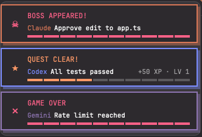

# Quest Toast

Notifications show as 8-bit game cards stacked in the top-right corner of the window instead of the bottom toast.
An agent that needs you is a boss, a finished task is a cleared quest worth XP, and an error is game over.
Each card is framed in the color of the agent that sent it (Claude, Codex, Gemini, Cursor, ...).

## What you see

- A column of up to 3 cards, 360 px wide, in a floating block at the top edge, aligned to the end (right).
  Newest on top.
  The block is empty, and so hidden, when there are no cards.
- Each card: theme `background`, a 2 px frame in the agent color, padding 12 by 8, `selection` on hover.
  Behind it, shifted 4 px down and right, a block in the agent color at 40% opacity: a hard pixel-game shadow.
  - Left: a 20 px glyph in the kind color, in a 24 px column.
    On a boss card it shakes 1 px left and right (`.loop("left", { from: -1, to: 1, period: 360 })`).
  - Heading, 13 px extra bold, in the kind color.
    A cleared quest that made a level says `LEVEL UP!`, and one that started the count again `REBORN!`.
    A combo adds its count after the heading: `QUEST CLEAR! x2 COMBO` (on a narrow card, see below).
  - Line two, 12 px: the agent name in the agent color, bold (at most 40% of the card width), then the notification body, truncated.
    The title comes first unless it is Herdr's own "X needs you" / "X finished" for a known agent.
    On the right, in `muted`: `+50 XP · LV n` on a cleared quest (`+60 XP · LV n` in a x2 combo, `★1 LV n` after a rebirth), `click to open` on a boss card that has an action.
  - Line three: a bar of 10 segments, 5 px high, 2 px apart.
    Lit segments are in the kind color, the rest in `selection`.
    Past LV 50 a bar that shows XP is lit in the metal, with the metal and its step after it in 10 px bold (`SILVER 2`).
    On a `LEVEL UP!` or `REBORN!` card the bar blinks (`.loop("opacity", { from: 0.3, to: 1, period: 500 })`).
- Kinds:

  | Kind | Heading | Glyph | Color | Bar |
  |---|---|---|---|---|
  | needs you | `BOSS APPEARED!` | `☠` blinking | theme `blocked` | all lit |
  | done | `QUEST CLEAR!` | `★`/`☆` | theme `done` | XP inside the level |
  | error | `GAME OVER` | `✕` | `ansi1` | all lit |
  | warning | `DANGER AHEAD` | `▲`/`△` | `ansi3` | all lit |
  | notice | `NEW MESSAGE` | `✦`/`✧` | `accent` | XP inside the level |
  | achievement | `ACHIEVEMENT!` | `✪`/`✫` | `ansi3` | all lit |

- XP: every cleared quest adds 50 XP, and 500 XP make a level, starting at level 1.
  Each card shows the level and the bar of the moment it arrived.
- Combo: a quest cleared by the same agent within 2 minutes of its last one is a combo.
  Each step adds 10 XP, up to 50 (x2 is 60 XP, x6 and on are 100 XP).
- Trim: from LV 51 each 5 levels are a step, 5 steps in each metal: `BRONZE` `#CD7F32`, `SILVER` `#C0C0C0`, `GOLD` `#FFD700`, `PLATINUM` `#E5E4E2`, `DIAMOND` `#7FE7FF`, `RAINBOW` `#FF77E9`.
  `RAINBOW 5` is LV 196 to 200.
  Past LV 200 the count starts again from LV 1 with a star: `★1 LV 1`, every 100,000 XP.
- Achievements, each earned once and shown as a card of its own, under the quest that earned it.
  The quest card always shows; when the column is full (boss cards, or several achievements at once), an achievement card may not, though it is still earned.

  | Achievement | For |
  |---|---|
  | `ROOKIE`, `VETERAN`, `HERO`, `LEGEND`, `MYTH` | 10, 100, 500, 1,000, 5,000 quests cleared |
  | `MARATHON`, `IRONMAN` | 50, 100 quests in one day |
  | `COMBO MASTER`, `UNSTOPPABLE` | a x5, x10 combo |
  | `ON FIRE`, `DEVOTED` | 7, 30 days in a row with a cleared quest |
  | `REBORN` | the first star |
  | `CLEAN DAY` | the first quest of a day after a day of 10 or more and no `error` cards |

- Agent colors: Claude `#D97757`, Codex `#7B8CFF`, Gemini `#8E75B2`, Cursor `#D6D8DB`, Copilot `#3FB950`, OpenCode `#F5A742`, Amp `#F34E3F`, Kiro `#9046FF`, Grok `#A0A4AB`, Kimi `#1783FF`, Crush `#FF6DAA`, Antigravity `#FFE432`, goose `#2EC4B6`, oh-my-pi `#A3E635`.
  Other agents use Herdr's own name for them, framed in the theme `accent`.
  Non-agent notifications show `Herdr`.
- Monospace font: the first installed of JetBrains Mono, SF Mono, Menlo, Cascadia Mono, Consolas, DejaVu Sans Mono; else the app font.
- A narrow spot, such as a sidebar: the floating block can pass a card width, `"content": { "mod": "toast-quest", "props": { "width": 228 } }` (default 360; a value under 180 counts as 180).
  Under 300 px the XP and `click to open` note moves to a row of its own, under line two.
  There the combo leaves the heading and ends that row, bold in the kind color (`+60 XP · LV n  x2`); the note is cut before the combo is.

## How it behaves

- Kind, in this order:
  1. The title is Herdr's own "X needs you" and X is an agent: a boss card.
     Herdr posts it with level `error`, so the title is read before the level.
     Herdr does not say whether the agent wants an approval or an answer, so both look the same.
  2. The title is Herdr's own "X finished" and X is an agent: a cleared quest (Herdr posts it with level `info`).
  3. Otherwise by level: `error`, `warning`, `success` (a cleared quest), anything else a notice card.
- `working`, `idle`: no card (Herdr posts none).
- Which agent, in this order: the terminal the notification's action focuses (`agents()` by address: its reported `app` and program key), the icon file name, then the program named in Herdr's own "X needs you" / "X finished" title.
  A title is read only on notifications whose action is `agent.focus`, and an icon only from Herdr's `icons/` folder, so "Cursor position saved" or "Amp server finished" from another mod stays a Herdr card.
  An agent that is not in the table and whose terminal is gone keeps the name from the title.
- XP is added when a cleared quest arrives, whether or not its card is still showing, and is kept in `shared("toast-quest.xp")`, so it survives restarts.
  The demo's cleared quest counts too.
- Quests cleared, each day's count and `error` cards (the last 60 days), running combos and earned achievements are kept in `shared("toast-quest.stats")`.
  The first time it is read, the quests cleared so far come from the XP (one per 50), and the quest-count achievements already passed are marked as earned without a card.
  Days follow the computer's local time.
- A new card always shows.
  It replaces older cards about the same terminal, so each agent shows its latest news once.
  More than 3 cards: the oldest card that is not a boss card goes first; when all are boss cards, the oldest of those.
- Click a card: run its action (Herdr's own go to the agent) and remove the card.
  Cards also leave after their timeout (default 10 s).
- Expired cards never show, even after Herdr restarts with an old queue.
- `herdr-app do toast-quest.demo` posts three sample cards: Claude boss, Codex quest clear, Gemini game over.
- `herdr-app do toast-quest.pick` numbers the cards (1 to 9) and takes the keyboard:
  a digit opens that card as a click would, `pick` again or Enter opens the top one; any other key gives the keyboard back to the pane it came from.
  Chords with cmd, ctrl or alt are let through, so the key bound to `pick` still works.
  A click elsewhere ends it too. Bind it to a key in the `global` section of `keys.json` to use it: `"cmd-j": "toast-quest.pick"`.

## Built from

- One mod, `mods/toast-quest/`: `mod.json` = `{ "place": "none" }`, `main.js` (draws the cards, keeps the XP) and `core.js` (the agent table, agent and kind detection, the card queue).
  It is used in two places in the person's layout:
  - Root: `"toast": "toast-quest"`.
    Herdr opens a copy for every notification with props `{title, body, level, icon, action, timeout, overlay}`.
    A copy with `overlay` and a string `title` adds a card to `shared("toast-quest.queue")` (newest first, 3 kept), adds the quest's XP to `shared("toast-quest.xp")` for a cleared quest, updates `shared("toast-quest.stats")`, adds a card for each achievement earned, and closes itself with `closeOverlay`.
    The card carries the XP total, the XP gained, the combo and whether it made a level, so the board never has to look them up.
  - A floating block on the node that holds the terminals: `{ "id": "toast-quest", "content": { "mod": "toast-quest" }, "edge": "top", "align": "end" }`.
    That copy draws the queue, drops expired cards once a second, and waits on `nextCommand()` for `demo` and `pick`.
- The shadow: each card sits in a `relative` box 4 px wider and taller, with an `absolute` block behind it at `top` 4, `left` 4.
- `herdr` functions: `props`, `closeOverlay`, `shared`, `setShared`, `agents`, `focused`, `run`, `theme`, `fonts`, `notify`, `nextCommand`.
- `core.js` is the same file in every herdr-agent-toast mod; a build from scratch can keep it in `main.js`.
- No icons, no network, no `exec`, no files read or written.

## Watch out

- Copying the folder alone changes nothing.
  Both layout entries are needed: without the root `toast`, Herdr's default toast shows; without the floating block, cards are queued but never drawn.
- Write `mod.json` (`place: none`) before the folder appears under `mods/`, or Herdr may dock it as a side panel first.
- Clone a shipped layout before editing it; edit the person's own layout otherwise.
- Do not sort by level first: Herdr's needs-you notification has level `error` and would show as a game-over card.
- `shared()` is saved to disk, so the queue survives a restart: filter expired cards whenever you read it.
- Add the XP in the copy that receives the notification, not in the copy that draws, or it is counted on every redraw.
- The shadow block comes before the card in the `relative` box, so the card is painted over it.
- `☠`, `★` and the other glyphs are not in every monospace font; Herdr falls back to another installed font for them.
- Agent colors are fixed hex values; on a light theme the pale ones (Cursor, Antigravity, oh-my-pi) are faint.
- Tested with Herdr app 0.1.16 on macOS (v1.0.0 and earlier: 0.1.15).

## Done when

1. `herdr-app check ~/.config/herdr-app/mods/toast-quest` passes.
2. `herdr-app status` shows no errors and lists `toast-quest` under `floats`.
3. `herdr-app do toast-quest.demo` shows three cards top right: Claude (orange frame, `BOSS APPEARED!`), Codex (blue frame, `QUEST CLEAR!`, `+50 XP`), Gemini (purple frame, `GAME OVER`).
4. Running the demo again lights one more bar segment on the Codex card; at 500 XP the bar empties and `LV` goes up.
5. With `"cmd-j": "toast-quest.pick"` in the `global` section of `keys.json`, cmd-j after the demo puts 1, 2 and 3 on the demo cards.
   Escape takes the numbers away and the keyboard goes back to the terminal it was on.
