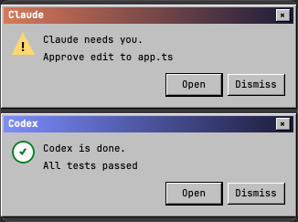

# Retro Toast

Notifications show as old desktop dialog boxes in the top-right corner of the window.
A grey raised box with a title bar that fades from the color of the agent that sent it (Claude, Codex, Gemini, Cursor, ...).
An icon for the kind, the message, and two buttons: **Open** goes to the agent, **Dismiss** closes the box.

## What you see

- A column of up to 2 boxes, 360 px wide, 6 px apart, in a floating block at the top edge, aligned to the end (right).
  Newest on top.
  The block is empty, and so hidden, when there are no boxes.
- Each box is grey `#C0C0C0` on every theme, with a raised edge: 1 px of white on the top and left; 1 px of `#808080` and then 1 px of black on the bottom and right.
  Text is black, 12 px, in the app font.
  - Title bar, 20 px high: a left-to-right gradient from the agent color to `#1B1B3A`, the agent name in bold white, and a small raised `×` button on the right.
  - Body, padding 10: a 28 px icon, then the message in two lines, each cut short when it is too long.
    Line one is `<name> <what happened>`: `Claude needs you.`, `Codex is done.`, `Gemini hit an error.`, `Herdr has a warning.`, `Herdr says:`.
    What happened is never cut short: when the line is full, the name is cut instead.
    Line two is the notification body; the title comes first unless it is Herdr's own "X needs you" / "X finished" for a known agent, or just the agent's name.
    With no title and no body there is no line two.
  - Buttons on the right: `Open` and `Dismiss`, 64 px wide at the least, raised, a shade darker while pressed.
    The first button has an extra dark line around it, as a default button does.
    A notification with nothing to open has `Dismiss` only.
- Icons: needs you, a yellow `#FFD866` triangle with `!`; done, a white circle with a green `#0A7D2A` ring and `✓`; error, a red `#D32F2F` circle with a white `✕`; warning, an orange `#FC9867` triangle with `!`; notice, a blue `#2F6FD6` circle with a white `i`.
- Agent colors: Claude `#D97757`, Codex `#7B8CFF`, Gemini `#8E75B2`, Cursor `#D6D8DB`, Copilot `#3FB950`, OpenCode `#F5A742`, Amp `#F34E3F`, Kiro `#9046FF`, Grok `#A0A4AB`, Kimi `#1783FF`, Crush `#FF6DAA`, Antigravity `#FFE432`.
  Other agents use Herdr's own name for them, and their title bar fades from navy `#000080`.
  Non-agent notifications show `Herdr`, also from navy.
- No icons from the agents and no fonts or sounds of their own.
- A narrow spot, such as a sidebar: the floating block can pass a box width, `"content": { "mod": "toast-retro", "props": { "width": 228 } }` (default 360; a value under 180 counts as 180).

## How it behaves

- Kind, in this order:
  1. The title is Herdr's own "X needs you" and X is an agent: needs you.
     Herdr posts it with level `error`, so the title is read before the level.
     Herdr does not say whether the agent wants an approval or an answer, so both look the same.
  2. The title is Herdr's own "X finished" and X is an agent: done (Herdr posts it with level `info`).
  3. Otherwise by level: `error`, `warning`, `success` (done), anything else a notice.
- `working`, `idle`: no box (Herdr posts none).
- Which agent, in this order: the terminal the notification's action focuses (`agents()` by address: its reported `app` and program key), the icon file name, then the program named in Herdr's own "X needs you" / "X finished" title.
  A title is read only on notifications whose action is `agent.focus`, and an icon only from Herdr's `icons/` folder, so "Cursor position saved" or "Amp server finished" from another mod stays a Herdr box.
  An agent that is not in the table and whose terminal is gone keeps the name from the title.
- A new box always shows.
  It replaces older boxes about the same terminal, so each agent shows its latest news once.
  More than 2 boxes: the oldest box that is not a needs-you box goes first; when both are needs-you boxes, the older one.
- `Open`: run the notification's action (Herdr's own go to the agent) and close the box.
- `Dismiss` and `×`: close the box.
- The box itself does nothing when clicked; only its buttons do.
- Boxes also leave after their timeout (default 10 s).
- Expired boxes never show, even after Herdr restarts with an old queue.
- `herdr-app do toast-retro.demo` posts three sample notifications: a Gemini error, then Codex done, then Claude needs you.
  Only two fit, so Claude and Codex show and the Gemini one is pushed out.
  The samples have no agent of their own, so their `Open` runs `agent.next` (show the next agent).

## Built from

- One mod, `mods/toast-retro/`: `mod.json` = `{ "place": "none" }`, `main.js` (draws the boxes) and `core.js` (the agent table, agent and kind detection, the card queue).
  It is used in two places in the person's layout:
  - Root: `"toast": "toast-retro"`.
    Herdr opens a copy for every notification with props `{title, body, level, icon, action, timeout, overlay}`.
    A copy with `overlay` and a string `title` adds a card to `shared("toast-retro.queue")` (newest first, 2 kept) and closes itself with `closeOverlay`.
  - A floating block on the node that holds the terminals: `{ "id": "toast-retro", "content": { "mod": "toast-retro" }, "edge": "top", "align": "end" }`.
    That copy draws the queue, drops expired cards once a second, and waits on `nextCommand()` for `demo`.
- The raised edge is three nested boxes, each with two sides of a border: `border_b(1).border_r(1)` black, `border_t(1).border_l(1)` white, `border_b(1).border_r(1)` grey.
- The title bar gradient and the triangles are painted shapes: `window.paint_path(path, Background.linear_gradient(90, from, to))` or `Background.solid(color)`, with `PathBuilder` and `Background` from `gpui-kit`, as a layer that fills its box (`absolute().top(0).left(0).size_full()`).
- The circles are `rounded_full()` boxes; the marks are text.
- `herdr` functions: `props`, `closeOverlay`, `shared`, `setShared`, `agents`, `run`, `notify`, `nextCommand`.
  No `theme()`: the desktop colors are fixed.
- `core.js` is the same file in every herdr-agent-toast mod; a build from scratch can keep it in `main.js`.
- No network, no `exec`, no files read or written.

## Watch out

- Copying the folder alone changes nothing.
  Both layout entries are needed: without the root `toast`, Herdr's default toast shows; without the floating block, cards are queued but never drawn.
- Write `mod.json` (`place: none`) before the folder appears under `mods/`, or Herdr may dock it as a side panel first.
- Clone a shipped layout before editing it; edit the person's own layout otherwise.
- Do not sort by level first: Herdr's needs-you notification has level `error` and would show as an error box.
- `shared()` is saved to disk, so the queue survives a restart: filter expired cards whenever you read it.
- Herdr ships its own retro layout with a pixel font and sounds; this mod uses none of them, so it looks the same on any layout and makes no sound.
- The boxes stay grey on a dark theme on purpose; they do not follow the theme.
- Tested with Herdr app 0.1.15 on macOS.

## Done when

1. `herdr-app check ~/.config/herdr-app/mods/toast-retro` passes.
2. `herdr-app status` shows no errors and lists `toast-retro` under `floats`.
3. `herdr-app do toast-retro.demo` shows two grey boxes top right:
   Claude (orange-to-navy title bar, yellow triangle, `Claude needs you.`, `Approve edit to app.ts`) above Codex (blue-to-navy title bar, green check, `Codex is done.`, `All tests passed`), each with `Open` and `Dismiss`.
4. `Dismiss` or `×` closes a box; `Open` on a real agent's box goes to that agent and closes it.
5. After 10 s untouched, boxes disappear and the block hides.
